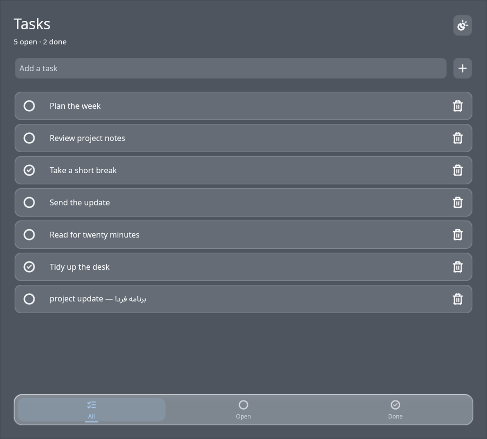

# Akari

**Build native apps in Rust with a message-driven UI and custom GPU rendering.**

Akari is an experimental GUI toolkit for Linux, Windows, macOS, Android, and
iOS. Applications describe their interface with reusable Rust components,
handle typed messages, and render through Akari's `wgpu` renderer. The default
theme is designed for everyday use; liquid glass is an optional visual effect.

[](https://github.com/metantesan/akari/actions/workflows/ci.yml)
[](LICENSE)
[](https://www.rust-lang.org/)

## Preview

The task app demonstrates the current input, task rows, completion controls,
filter tabs, theme switch, and mixed English/Persian text.



Run the task app from a checkout with stable Rust and a working graphics
driver:

```sh
cargo run -p akari-tasks
```

The component showcase is also available with `cargo run -p akari-showcase`.

## Highlights

- Rust component API with typed messages and application-owned state
- Custom `wgpu` renderer with Akari's own shaders and GPU resource management
- Reusable controls, layout, navigation, media, and feedback components
- Lucide icons generated from the vendored SVG pack at build time
- System theme and locale integration, with Fluent localization support
- Separate Android/Kotlin and iOS/Swift application hosts
- Cargo feature flags for optional `components` and `icons` crates

## Platform status

Linux desktop and Android on a physical phone have received runtime testing.
Windows, macOS, and iOS have not yet been runtime-verified. CI checks Rust
builds on Linux, Windows, and macOS; mobile build and device validation are
still in progress. A successful build does not count as runtime verification.

## Create an app

The Akari CLI scaffolds a standalone project with Rust sources and native
Android/Kotlin and iOS/Swift host code. From the Akari workspace:

```sh
cargo run -p akari-cli -- new "Daily Notes" --app-id com.akari.notes
```

The framework package is named `akari-gui` on Cargo, while its Rust library is
imported as `akari`. Akari framework crates are maintained in this Git
repository. Generated projects use the Git source; they do not need to publish
the framework crates to crates.io.

The CLI package is prepared for crates.io distribution as `akari-cli`. After
its first release, install it with:

```sh
cargo install akari-cli
akari new "Daily Notes" --app-id com.akari.notes
```

Use `--path .` with the workspace command when developing the toolkit locally.
Run `akari --help` for the available project, build, and bundle commands.

## Workspace layout

```text
crates/akari           Public toolkit facade and feature flags
crates/akari-core      Widget tree, events, layout, and theme types
crates/akari-renderer  wgpu renderer, text, icons, and shaders
crates/akari-platform  Window lifecycle and platform event integration
crates/akari-native    Clipboard, theme, directories, and localization APIs
crates/akari-components Reusable widgets
crates/akari-icons     Generated Lucide icon pack
crates/akari-cli       Project generator and app build tools
examples/showcase     Component showcase application
examples/tasks        Task-list example application
```

## Development

```sh
cargo fmt --all -- --check
cargo check --workspace --all-targets
cargo test --workspace
cargo deny check
```

Install cargo-deny with `cargo install cargo-deny --locked --version 0.20.2`.
See [CONTRIBUTING.md](CONTRIBUTING.md) for pull request guidelines and
[SECURITY.md](SECURITY.md) for private vulnerability reports.

## License

The workspace-root [LICENSE](LICENSE) is the license source for all crates. It
contains BSD 3-Clause terms for Akari-authored code plus the applicable Lucide
and Gradle Wrapper third-party license texts and notices.

## Releasing the CLI

To publish the CLI, update the workspace version and push a Git tag named
`akari-cli-v<version>`. The workflow checks the tag and publishes only
`akari-cli`. Configure the repository Actions secret
`CARGO_REGISTRY_TOKEN`; the framework crates remain unpublished.
